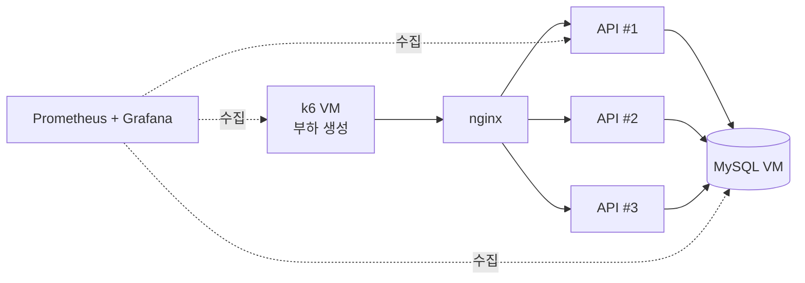
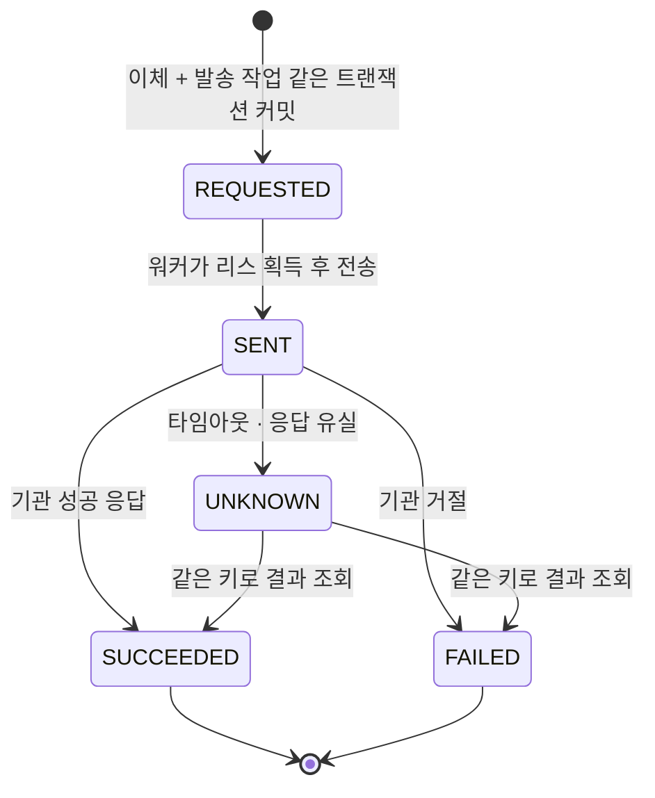

# 백엔드 포트폴리오 5장 원고 — ledger-reliability-lab

> **목표 원고다. 모든 `[ ]`는 실제 구현·측정 후 채운다.** 완료되지 않은 장은 제출본에서 빼고, 빈칸이 남은 장을 제출하지 않는다. 대상 직군은 일반 백엔드, 인프라·분산 시스템, 글로벌 소프트웨어 엔지니어다. AI 백엔드는 별도 소규모 프로젝트로 보완한다.

## 0. 프로젝트 한 줄과 공통 측정 환경

**프로젝트:** ledger-reliability-lab — 송금·원장 백엔드를 대상으로 처리량 한계, 동시성 정합성, 장애 신뢰성, 대용량 배치를 **실측으로 검증한** 개인 프로젝트. 돈은 한 건이라도 틀리면 안 되기 때문에 정합성과 성능을 같은 실험에서 함께 확인하기 좋은 대상으로 골랐다.

**기술:** Java 25, Spring Boot 4, Spring Data JPA, MySQL 8.4, Docker Compose, GitHub Actions, k6, Prometheus, Grafana, `[클라우드]`
**저장소:** github.com/gyugyutae/ledger-reliability-lab · 기간 `[시작–종료]`

### 측정 환경 ENV-1 (모든 장이 이 환경을 참조한다)

| 항목 | 고정값 |
|---|---|
| 서버 | k6 / API / MySQL를 **서로 다른 VM**에 배치, 같은 가용 영역, 비버스터블(c·m 계열) `[인스턴스 타입]` |
| API 컨테이너 | 컨테이너당 `[CPU 1 / 메모리 1GiB]` 고정, HikariCP `[기본값]` |
| DB | MySQL 8.4 `[vCPU·메모리·스토리지]`, 격리 수준 REPEATABLE READ, buffer pool `[크기]` |
| 데이터 | 계좌 `[100,000]`개, 원장 `[N]`건 사전 적재 |
| 부하 | k6 `constant-arrival-rate`, 워밍업 2분 → 측정 5분, **3회 반복 중앙값** |
| 안정 기준(SLO) | **p99 < `[200]`ms, 오류율 < 0.1%** 를 유지하는 최대 RPS = "최대 안정 처리량" |
| 지표 | API p50/p99·오류율·처리 TPS, HikariCP active/pending, JVM CPU·GC, InnoDB row lock 대기·`Innodb_deadlocks`·버퍼 풀 적중률, 노드 CPU·iowait·steal |
| 기록 | 실험마다 `experiments/<ID>/`에 커밋 해시·k6 스크립트·원본 결과 JSON·Grafana 스냅샷 |

### 모든 장의 고정 형식

모든 장은 같은 순서로 읽힌다. 독자는 다음에 무엇이 나올지 예측할 수 있어야 한다.

1. **제목** — 무엇이 문제였는지 한 문장
2. **핵심 결과** — 가장 중요한 수치 한 줄
3. **그림 1개**
4. **문제 원인** — 3줄
5. **해결 과정** — 3~4줄 + **비교표 1개**
6. **결과** — 수치 3~4개 · 조건(ENV·실험 ID) · 한계·근거

| 장 | 역할 | 그림 | 비교표 | 결과 수치 |
|---|---|---|---|---|
| 1 | 시스템 전체 처리량 | 처리량-지연 곡선 (Grafana) | 실험 E1~E5 결과 | 최대 안정 RPS · 확장 배율 · 최적 풀 크기 · 병목 자원 |
| 2 | 단일 DB 안의 경합 | 락 대기·교착 전후 그래프 | 락 방식 3종 비교 | 교착 · 재시도 · 핫 계좌 TPS · p99 |
| 3 | 한 건 단위 외부 효과의 정확성 | 거래 상태 전이도 | 장애 시나리오 × 전/후 | 유실 · 중복 효과 · 복구 시간 · 미확정 체류 |
| 4 | 대량 데이터 처리의 효율 | 배치 중 API p99 타임라인 | 처리 방식 4단계 비교 | 처리 시간 · 재개 재처리량 · API p99 영향 · 탐지 정확도 |
| 5 | 협업 | (개인 4장 완성 후 결정) | | |

장 사이 연결: 1장에서 **측정으로 병목을 찾고** → 2장에서 **그 병목(락)을 바꾸고** → 3장에서 **DB 바깥(외부 호출·워커)으로 범위를 넓히고** → 4장에서 **같은 환경에 배치를 얹어 온라인 서비스와의 자원 경쟁을 다룬다.**

---

## 1장 — 서버를 늘리면 처리량도 늘어날까: 단일 서버 한계와 확장 특성 실측

**핵심 결과:** 단일 서버 최대 안정 처리량 `[X] RPS`, API 3대에서 `[Y] RPS(×[배율])` — 병목은 `[CPU / 커넥션 풀 / DB 락 / IO]`

### 그림

`[Grafana: x축 요청 RPS, y축 p99 — API 1·2·3대 곡선을 겹친 처리량-지연 곡선. SLO 선(p99 200ms) 표시]`

### 문제 원인

- 증설 판단에는 "한 대가 어디까지 버티는지"와 "늘리면 얼마나 늘어나는지"가 필요하지만, 가정한 사용자 수로 계산한 RPS는 실제 시스템 한계를 알려주지 않는다.
- `[E1 측정]`에서 `[X] RPS`를 넘으면 p99가 급격히 증가했고, 그 시점에 `[먼저 포화된 자원]`이 포화됐다.
- 원인을 모른 채 서버만 늘리면, 병목이 DB에 있을 경우 비용만 늘고 처리량은 늘지 않는다.

### 해결 과정

- 부하 생성기·API·DB를 분리한 ENV-1을 구성하고, 안정 기준(SLO)을 먼저 정의한 뒤 RPS를 단계적으로 올렸다.
- 한 번에 한 변수만 바꾸는 실험 E1~E5를 설계했다. 대수(E2), 계좌 집중도(E3), 커넥션 풀 크기(E4)를 각각 바꿨다.
- 같은 시간축의 Grafana 패널(CPU·Hikari pending·InnoDB 락 대기·iowait)로 처리량 꺾임 지점의 원인 자원을 판별했다(E5).

| 실험 | 바꾼 값 | 최대 안정 RPS | p99 | 포화 자원 |
|---|---|---|---|---|
| E1 단일 서버 | RPS 단계 | `[ ]` | `[ ]` | `[ ]` |
| E2 수평 확장 | API 1 → 2 → 3대 | `[ ]→[ ]→[ ]` | `[ ]` | `[ ]` |
| E3 핫 계좌 | 집중도 0 / 50 / 90% | `[ ]` | `[ ]` | `[InnoDB 락 대기?]` |
| E4 풀 크기 | 5 / 10 / 20 / 50 | `[최적 N]` | `[ ]` | `[ ]` |

### 결과

**변화:** 최대 안정 `[X] RPS` → 3대 `[Y] RPS(×[배율])` · 최적 풀 크기 `[N]`(그 이상에서 p99 `[악화 수치]`) · 집중도 90%에서 처리량 `[감소율]`.
**판단:** 일반 트래픽은 `[수평 확장으로 해결된다/안 된다]`, 핫 계좌는 서버 대수와 무관하게 `[DB 행 락]`이 상한을 정한다 → **2장에서 이 병목을 다룬다.**
**조건:** ENV-1, 실험 E1~E5, 3회 반복 중앙값 `[편차]`.
**한계·근거:** 단일 MySQL 노드 기준이며 절대 수치보다 확장 특성이 핵심이다. `[experiments/E1~E5 링크]`.

---

## 2장 — 특정 계좌에 송금이 몰리면 서버를 늘려도 처리량이 늘지 않는 문제

**핵심 결과:** 교착 `[N] → 0`건, 핫 계좌 처리량 `[A] → [B] TPS`, 정합성 위반 0건

### 그림

`[Grafana: E3 재실행 시 InnoDB 락 대기 시간·Innodb_deadlocks 증가량 — 변경 전/후 나란히]`

### 문제 원인

- 1장 E3에서 집중도가 높아지면 처리량이 `[감소율]` 떨어지고 InnoDB 락 대기와 교착이 `[N]`건 발생했다.
- `[SHOW ENGINE INNODB STATUS·코드]`로 확인한 원인: A→B와 B→A 이체가 **서로 다른 순서로 두 계좌 행의 락을 잡아** 교착이 생기고, 교착 rollback 후의 재시도가 부하를 키웠다.
- 출금·입금·원장 기록은 한 트랜잭션으로 묶었고, 실패 지점 4곳에 예외를 주입하는 테스트로 부분 반영이 없음을 먼저 확인했다. 따라서 문제는 원자성이 아니라 **경합 비용**이었다.

### 해결 과정

- 같은 요청 분포(E3)에서 잔액 차감 방식 3가지를 정확성·처리량·p99·재시도 기준으로 비교했다.
- **계좌 ID 오름차순으로 락을 획득**하도록 바꿔 락 순서 역전을 없앴다.
- 락을 잡은 구간에서 불필요한 조회와 처리를 빼서 락 보유 시간을 줄였다.
- 별도 DB 연결의 검증 SQL로 전체 잔액 합 보존과 계좌별 `잔액 = 원장 합계`를 매 실험 후 확인했다.

| 방식 | 정확성 | 핫 계좌 TPS | p99 | 재시도·교착 | 선택 |
|---|---|---|---|---|---|
| 비관적 락 (`SELECT … FOR UPDATE`) | `[ ]` | `[ ]` | `[ ]` | `[ ]` | |
| 낙관적 락 (`@Version` + 재시도) | `[ ]` | `[ ]` | `[ ]` | `[ ]` | |
| 조건부 UPDATE (`WHERE balance >= ?`) | `[ ]` | `[ ]` | `[ ]` | `[ ]` | |
| 선택 방식 + ID 순서 락 | `[ ]` | `[ ]` | `[ ]` | `[ ]` | ✔ `[이유]` |

### 결과

**변화:** 교착 `[N] → 0`건 · 재시도 `[N] → [M]`회 · 핫 계좌 TPS `[A] → [B]` · p99 `[ ] → [ ]` · 정합성 위반 0건(`[N]`회 실험).
**조건:** ENV-1, 실험 E3 재실행(변경 전/후), 집중도 `[90%]`, 양방향 이체 비율 `[ ]`.
**한계·근거:** 한 계좌의 처리량 상한은 행 락 직렬화로 여전히 남는다. 더 높이려면 잔액 분할이나 비동기 반영이 필요하지만 범위 밖으로 두었다. `[코드·검증 SQL·experiments/E3-after]`.

---

## 3장 — 외부 송금 처리 중 워커가 죽거나 응답이 끊기면 작업이 유실되거나 두 번 송금되는 문제

**핵심 결과:** 워커 강제 종료 `[N]`회에서 유실 0건 · 중복 금전 효과 0건 · 복구 `[T]`초 이내

### 그림

### 문제 원인

- 외부 기관 호출을 요청 스레드에서 바로 하면, 처리 도중 프로세스가 죽었을 때 **보내야 할 작업이 사라진다**. `[개선 전 kill 실험의 유실 건수]`
- 응답이 끊긴 요청을 실패로 보고 다시 보내면, 기관이 이미 처리한 경우 **두 번 송금된다**. `[개선 전 중복 효과 건수]`
- 타임아웃은 "실패"가 아니라 "결과를 모름"이다. 이 상태를 표현하지 못한 것이 근본 원인이었다.

### 해결 과정

- 이체와 발송 작업(Outbox)을 **같은 트랜잭션으로 저장**해, 커밋된 이체는 반드시 발송 작업을 가진다.
- 워커는 `SELECT … FOR UPDATE SKIP LOCKED`로 작업을 가져가고 **리스(`locked_until`)** 를 둔다. 죽은 워커의 작업은 리스 만료 후 다른 워커가 다시 가져간다.
- 모든 요청에 **멱등성 키**를 붙이고, 기관 쪽 unique 제약으로 같은 키의 두 번째 요청은 기존 결과를 돌려준다. 결과를 모를 때는 UNKNOWN으로 두고 같은 키로 조회해 확정한다.
- 상태 변경은 `UPDATE … WHERE status = ?` 조건부 갱신으로만 해서 허용되지 않은 전이와 동시 확정을 막았다.

| 장애 시나리오 | 개선 전 | 개선 후 |
|---|---|---|
| 전송 전 워커 `kill -9` | 유실 `[ ]`건 | 유실 0 · 재처리 `[T]`초 |
| 기관 커밋 직후 워커 `kill -9` | 중복 `[ ]`건 | 중복 0 (멱등성 키) |
| 기관 응답 유실 (타임아웃) | 잘못된 실패 처리 `[ ]`건 | UNKNOWN → 조회로 확정 |
| 워커 2대가 같은 작업 경합 | 중복 실행 `[ ]`건 | SKIP LOCKED로 0 |

### 결과

**변화:** 강제 종료 `[N]`회 · 요청 `[M]`건에서 유실 0 · 중복 금전 효과 0 · 복구 시간 p99 `[T]`초 · UNKNOWN 체류 p99 `[ ]`초 · 외부 처리 경로 처리량 `[ ] TPS`.
**조건:** ENV-1 + 모의 기관 서버(장애 주입: 지연·커밋 후 응답 차단), 워커 `[N]`대, 강제 종료 주기 `[ ]`, 반복 `[N]`회.
**한계·근거:** 모의 기관 기준이며 실제 기관의 멱등성 보장은 계약에 따라 다르다. 보장은 "최소 한 번 실행 + 멱등성 = 금전 효과 정확히 한 번"이다. `[영문 RFC 링크 · 장애 실험 스크립트 · 검증 SQL]`.

---

## 4장 — 원장 대사 배치가 느리고, 중단되면 처음부터 다시 돌며, 온라인 API를 느리게 만드는 문제

**핵심 결과:** 대사 처리 `[A] → [B]분` · 재개 시 재처리 `[전체] → [청크 1개]` · 배치 중 API p99 증가 `[+X] → [+Y]ms`

### 그림

`[Grafana 타임라인: 배치 실행 구간 동안 API p99와 DB IO — 개선 전/후 두 줄]`

### 문제 원인

- 계좌별 `잔액 = 원장 합계`를 검사하는 대사 배치가 OFFSET 페이징이라, 뒤로 갈수록 느려져 `[N]`건에서 `[A]`분이 걸렸다. `[EXPLAIN 결과]`
- 진행 위치를 저장하지 않아, 중간에 중단되면 처음부터 다시 처리했다.
- 배치가 DB IO와 커넥션을 점유해, 같은 시간대 API p99가 `[+X]ms` 증가했다.

### 해결 과정

- 정답 불일치 `[N]`건을 주입한 데이터를 만들어 탐지 정확도를 먼저 고정했다.
- OFFSET을 **keyset 페이징(`WHERE id > ?`)** 으로 바꾸고, 대사 조회에 맞는 인덱스를 EXPLAIN과 동일 데이터 실측으로 검증했다.
- 청크마다 **체크포인트**를 저장해, 중단 후 마지막 청크부터 재개하도록 했다.
- ENV-1에서 k6로 API 부하를 거는 동안 배치를 실행하고, **청크 크기와 처리 속도 제한**으로 API p99 영향을 줄였다.

| 단계 | 처리 시간 | 재개 시 재처리 | 배치 중 API p99 | 탐지 정확도 |
|---|---|---|---|---|
| OFFSET (기준) | `[ ]` | 전체 | `[ ]` | `[N/N]` |
| + keyset + 인덱스 | `[ ]` | 전체 | `[ ]` | `[N/N]` |
| + 체크포인트 | `[ ]` | 청크 1개 | `[ ]` | `[N/N]` |
| + 속도 제한 | `[ ]` | 청크 1개 | `[ ]` | `[N/N]` ✔ |

### 결과

**변화:** 처리 시간 `[A] → [B]` · 재개 재처리 `[전체 N건] → [청크 크기]건` · 배치 중 API p99 증가 `[+X] → [+Y]ms` · 탐지 정확도 `[N/N]`, 누락·중복 0.
**조건:** ENV-1, 원장 `[N]`건, 청크 `[크기]`, 동시 API 부하 `[RPS]`, 중단 위치 `[ ]`, 반복 `[N]`회.
**한계·근거:** 속도 제한은 배치 완료 시간을 `[+Z]` 늘리는 비용이 있다. 내부 원장 대사이며 외부 기관 명세 대사는 다루지 않는다. `[SQL·EXPLAIN·experiments/B1~B4]`.

---

## 5장 — 협업 `[보류]`

개인 1~4장을 완성한 뒤 주제를 정한다. 형식은 1~4장과 같다(제목 → 핵심 결과 → 그림 → 문제 원인 → 해결 과정 + 비교표 → 결과).

---

## 구현 순서 `[제출 시 삭제 — 구현 참고용]`

문서 순서(1→2→3→4)와 구현 순서는 다르다. 2장의 "측정해서 병목을 찾고 락을 바꿨다"가 진짜가 되려면, **락을 바꾸기 전에 먼저 측정해야 한다.**

| 단계 | 할 일 | 끝났다는 기준 | 연결 장 |
|---|---|---|---|
| **S0 기반** | JPA 전환 완료, 원장 테이블, 출금·입금·원장 한 트랜잭션 이체, 실패 지점 예외 주입 테스트 | 부분 반영 0을 테스트로 확인 | 2장 한 줄 |
| **S1 기준 구현** | 가장 단순한 비관적 락으로 이체(순서 정렬 **하지 않음**), 동시 이체 정확성 테스트, 잔액·원장 검증 SQL | 동시 테스트에서 잔액 불일치 0 | 2장 "변경 전" |
| **S2 운영 기반** | Dockerfile, Compose(app·MySQL·Prometheus·Grafana·exporter), Actuator·Micrometer, GitHub Actions(테스트·이미지 빌드·GHCR 푸시), k6 스크립트 | 로컬에서 대시보드에 지표가 보임, PR마다 CI 통과 | 전체 |
| **S3 측정 환경** | 클라우드에 ENV-1 구성, 띄우고 내리는 스크립트, `experiments/` 기록 규칙 | 같은 실험 3회 편차 `[10%]` 이내 | 1장 |
| **S4 1장 실측** | E1~E5 실행, 병목 판별 | 1장 표 채움 | 1장 |
| **S5 락 개선** | 락 방식 3종 비교, ID 순서 락, 락 보유 구간 축소, E3 재측정 | 교착 0, 2장 표 채움 | 2장 |
| **S6 신뢰성** | **시작할 때 영문 RFC 작성** → 모의 기관 서버, 상태 머신, Outbox, 워커 리스, 멱등성 키, `kill -9` 실험 → RFC에 Results 추가 | 유실·중복 0, 3장 표 채움 | 3장 |
| **S7 배치** | 대량 데이터 적재, 대사 배치(OFFSET 기준), keyset·인덱스, 체크포인트, 동시 부하 하 속도 제한 | 4장 표 채움 | 4장 |
| **S8 마무리** | 5장 협업 주제 논의, 영문 README 결과표 갱신, 이력서 요약 갱신 | 제출본에 `[ ]` 0개 | 전체 |

**시간이 부족할 때 자르는 순서:** S7(4장) → S6 범위 축소(워커 1대·시나리오 2개). S0~S5까지만 끝나도 1·2장으로 제출할 수 있다.

### 영문 문서

- **README (영문):** 2026-11-07 추가. 실험이 끝날 때마다 Results 표를 갱신한다.
- **설계 문서 (영문 RFC):** **3장 구현(S6)을 시작할 때** `docs/rfc/0001-reliable-external-transfer.md`로 쓴다. 구성은 Context → Goals / Non-goals → Options(즉시 호출 / Outbox + 워커) → Decision → Failure modes → (구현 후) Results. 구현 전에 쓴 설계가 실험으로 어떻게 검증됐는지가 남도록 Results는 나중에 추가한다.
